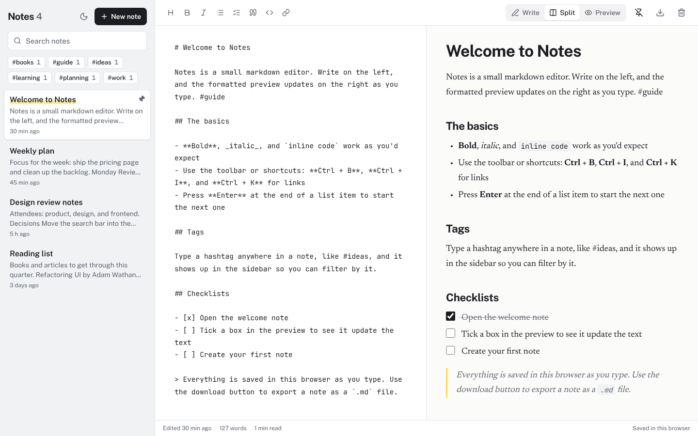

# Markdown Notes

A notes app with a live Markdown preview, built with React, TypeScript, and Tailwind CSS. Write on one side and see the formatted note on the other, organize notes with hashtags, tick off checklists right in the preview, and export any note as a `.md` file. Everything is saved in the browser.

**Live demo:** _add your Vercel link here_



## Features

- Write, Split, and Preview layouts, with the editor and preview side by side on large screens
- Formatting toolbar and shortcuts: **Ctrl + B** bold, **Ctrl + I** italic, **Ctrl + K** link
- Lists that continue when you press Enter, and end when you press Enter on an empty item
- Clickable checklists: tick a box in the preview and the Markdown updates
- Hashtags anywhere in a note become tags in the sidebar, with counts and filtering
- Search across all notes
- Pin notes to the top; the rest are sorted by last edit
- Export a note as a `.md` file
- Undo after deleting a note
- Word count and reading time
- Markdown rendered with [marked](https://marked.js.org/) and sanitized with [DOMPurify](https://github.com/cure53/DOMPurify), so pasted HTML can't run scripts
- Light and dark themes with a toggle, responsive layout with a list and editor view on phones
- Keyboard shortcuts: **Alt + N** for a new note, **/** to search

## Tech stack

- [React 19](https://react.dev/) with TypeScript
- [Vite](https://vite.dev/) and [Tailwind CSS v4](https://tailwindcss.com/)
- [marked](https://marked.js.org/) and [DOMPurify](https://github.com/cure53/DOMPurify)
- [Lucide](https://lucide.dev/) icons and [Fontsource](https://fontsource.org/) fonts (Public Sans, Newsreader, JetBrains Mono)

## Getting started

You need [Node.js](https://nodejs.org/) 20.19 or newer.

```bash
git clone https://github.com/<your-username>/markdown-notes.git
cd markdown-notes
npm install
npm run dev
```

Then open http://localhost:5173.

| Command           | What it does                        |
| ----------------- | ----------------------------------- |
| `npm run dev`     | Starts the dev server               |
| `npm run build`   | Type-checks and builds to `dist/`   |
| `npm run preview` | Serves the production build locally |

## Project structure

```
src/
├── components/
│   ├── Editor.tsx       Editor pane, toolbar actions, and layout switcher
│   ├── Preview.tsx      Rendered note with clickable checklists
│   ├── Sidebar.tsx      Note list, search, and tags
│   ├── Toast.tsx
│   └── Toolbar.tsx
├── hooks/
│   ├── useLocalStorage.ts
│   ├── useMediaQuery.ts
│   ├── useNotes.ts      Create, update, pin, delete, and restore notes
│   └── useTheme.ts
├── lib/
│   ├── editing.ts       Text transforms for the toolbar and list continuation
│   ├── markdown.ts      Rendering and sanitizing
│   ├── note-text.ts     Titles, excerpts, tags, word counts, and checklist toggling
│   ├── sample.ts        Sample notes
│   └── types.ts
├── App.tsx
├── index.css
└── main.tsx
```

## Deploying

Import the repository at [vercel.com/new](https://vercel.com/new) and click **Deploy**. Vite is detected automatically.
